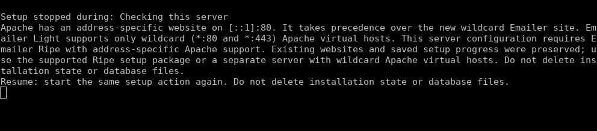
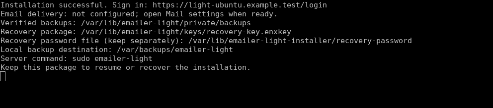
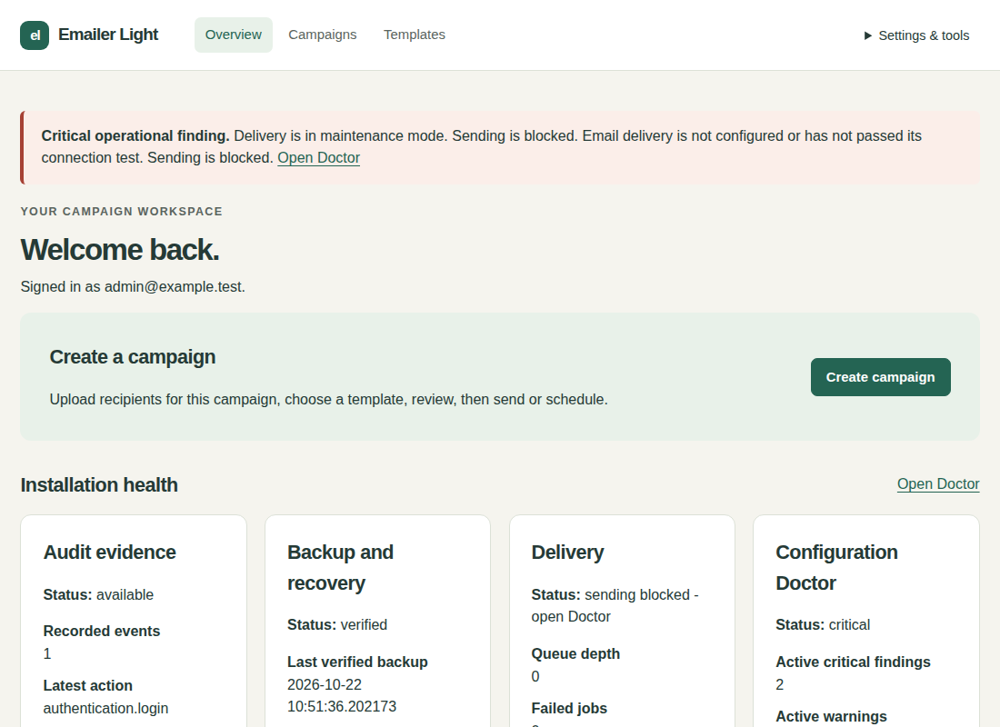
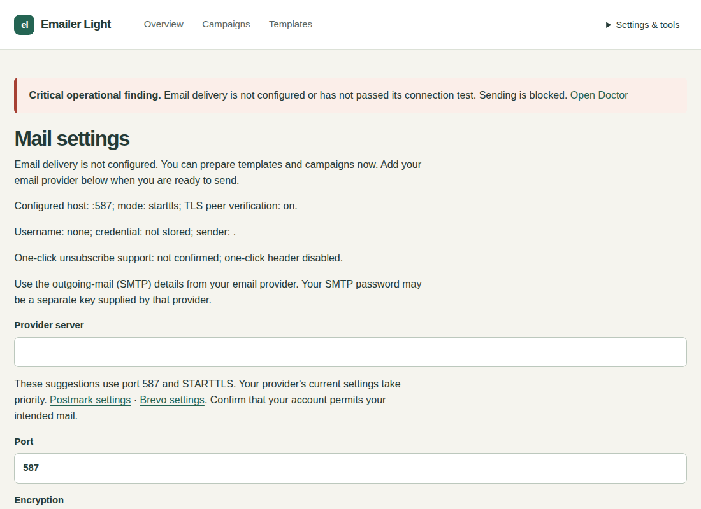

# Install Emailer Light

Version 1.2.15 | Beginner guide | Ubuntu Apache or Debian Nginx VPS

Install a usable Emailer Light website with one guided server setup. You need your administrator email, a new password, and the address you want people to use. Email delivery can wait.

Ubuntu Apache can coexist with Nginx on a separate port (tested: 8081). Setup manages only Apache and the Emailer instance. Every existing listener on ports 80 and 443 must belong to apache2.service; a different service on either port or an overlapping Emailer hostname stops setup with existing services preserved. Light supports only wildcard Apache virtual hosts (*:80 and *:443). A server with address-specific Apache virtual hosts requires Emailer Ripe with address-specific installation support. Keep your existing websites unchanged; do not delete installer state or database files.



## Who can use this guide?

Use a virtual server with Ubuntu 22.04 LTS, 24.04 LTS or 26.04 LTS and Apache, or Debian 13 and Nginx. It must be amd64/x86-64, use systemd, and let you run sudo. Setup chooses Apache on a clean Ubuntu host and Nginx on a clean Debian 13 host. Earlier profiles were tested with 2 CPU cores, 3 GB memory and a 24 GB disk. The Ubuntu 26.04.1 Virtualmin fixture has 4 CPU cores, 6 GB memory and a 40 GB disk. Ubuntu 22.04 needs at least 5 GiB free; other supported profiles need 2 GiB. Leave additional space for uploads and backups.

An existing Apache website using PHP 8.1 can stay on Ubuntu 22.04, including its existing database and unrelated services. Give Emailer a spare hostname. Setup adds its own PHP runtime and application services without changing the existing website’s PHP selection. Ubuntu 22.04 also gets a separate supported database; it does not upgrade an older shared database. Ubuntu 24.04, Ubuntu 26.04 and Debian 13 reuse a compatible local MariaDB server. An incompatible existing database on those profiles stops setup before packages change.

Ubuntu 26.04 uses distribution PHP 8.5 and MariaDB 11.8. Virtualmin is tested with wildcard Apache websites (*:80 and *:443). Choose an Emailer hostname that is not already a Virtualmin domain or alias; setup adds its own site and keeps your existing sites and PHP settings. Missing PHP extensions are installed automatically. Continue managing Emailer with this setup file; do not import its site into Virtualmin. Public certificate issuance has not been independently verified for this profile; see the HTTPS evidence and limitation in the operator reference.

| Tested server | Website software | Handled automatically |
| --- | --- | --- |
| Ubuntu 22.04.5 LTS, amd64/systemd | Apache 2.4.52 | PHP 8.4.26; dedicated MariaDB 10.11.19 alongside the host database |
| Ubuntu 24.04.5 LTS, amd64/systemd | Apache 2.4.58 | PHP 8.4.26; distribution MariaDB 10.11.14 |
| Ubuntu 26.04.1 LTS, amd64/systemd | Apache 2.4.66; Virtualmin 8.3.0 / Webmin 2.670 | Distribution PHP 8.5.4-0ubuntu1.5; MariaDB 11.8.6-5ubuntu0.1; dedicated Emailer PHP-FPM pool |
| Debian 13 Trixie, amd64/systemd | Nginx 1.26.3 | PHP 8.4.26; MariaDB 11.8.6 |

Only these OS/web-server combinations are supported. Ubuntu using Nginx as its public web server on ports 80/443, Debian 13 with Apache, ARM, custom website ports/subfolders and ordinary file-upload hosting are outside this installer’s tested scope. On a VPS that also hosts other websites, Emailer needs its own dedicated hostname; existing websites retain their configuration and operation.

Ordinary file-upload/shared hosting cannot run this installer: Emailer needs a persistent background worker, scheduled services and private key storage outside the website. Uploading PHP files alone cannot provide these requirements. Use the supported VPS path.

On Ubuntu 22.04 and 24.04, setup adds the maintained Ondřej Surý PHP package source and verifies its signing identity automatically. Ubuntu 22.04’s separate database receives security patches through reviewed Emailer maintenance releases, rather than the server’s ordinary package updates. Keep Emailer maintenance releases current; you do not need to assemble or configure the database yourself.

## 1. Get your server and website address ready

Sign in to your hosting provider's server console or use its SSH instructions. This is the terminal where you paste the setup action below. You need the provider's server sign-in; it is separate from the new Emailer account.

Choose a spare address such as `news.your-domain.com`. In your domain provider's DNS controls, point its A record to this server's public IPv4 address. Add an AAAA record only if this server actually accepts public IPv6. Allow incoming TCP ports 80 and 443 in the hosting firewall. Do not take over an existing website address. Setup cannot edit your domain or hosting-provider account without access to that account.

## 2. Download the official setup package

In the server terminal, paste this download action. It saves the official installation package in your current folder.

```bash
curl --fail --location --output emailer-light-1.2.15-setup.run \
  https://github.com/Attory/emailer-light/releases/download/v1.2.15/\
emailer-light-1.2.15-setup.run
```

Or download **emailer-light-1.2.15-setup.run** from the [official release](https://github.com/Attory/emailer-light/releases/tag/v1.2.15) in your browser and upload that one file using your provider's file-transfer facility. If curl is unavailable, use that browser download/upload path.

Initial trust comes from obtaining the setup action itself from the official HTTPS release or an authorized private channel. Its embedded, established edition signing identity then verifies the package inventory, runtime and release identity before installer code runs. A key supplied beside an arbitrary download would not establish that initial trust.

Ubuntu 22.04 also retrieves an authenticated MariaDB runtime of about 360 MB. Allow time for this download; progress is saved and an interrupted download resumes when you start the same setup file again. No container software or Composer command is needed.

## 3. Start setup

From the folder containing the downloaded file, paste this single setup action:

```bash
sudo sh emailer-light-1.2.15-setup.run
```

sudo may ask for your server account password once. Setup needs host permission to install services; the application itself runs under a dedicated account. Keep the terminal open. Password entry is hidden, so no letters or dots may appear.

1. Enter **Application hostname** if asked: just your dedicated address, without https://, a port or a path. Setup does not assume the machine's name is a public website.
2. Enter **Administrator email**. This becomes your sign-in name.
3. Enter a strong **Administrator password** and enter it again. Use 15-256 characters.
4. On Ubuntu 22.04 fresh setup creates its own database without asking for database details. On Ubuntu 24.04, Ubuntu 26.04 or Debian 13, enter a database administrator sign-in only if the existing local MariaDB server needs it; passwords are hidden.

You will see named progress steps for dependencies, package verification, private folders, database and account, services, backup/recovery, HTTPS and health. Organisation name defaults to Emailer; language to English and scheduling timezone to UTC. SMTP details are not required.



## 4. Sign in

Wait for **Installation successful**. Open the printed HTTPS login address in your browser and sign in with the email and password you entered. Setup has already installed the worker, scheduler, maintenance jobs and command launcher and verified the initial backup. Do not proceed past a browser certificate warning; use the HTTPS troubleshooting entry below.



## 5. Configure email now or later

You can prepare templates and draft campaigns immediately. **Email delivery is not configured** means actual sending is blocked. No campaign is approved or sent during installation.

When ready, open **Settings & tools > Mail settings** and enter your provider details. **Test connection without sending** tests the current visible fields without saving or emailing anyone. If it says Current settings tested successfully—save to apply, choose **Save SMTP settings**. A blank password reuses a saved password only for the same host and username. **Test saved connection** checks only the already-saved configuration. To send one requested message, enter your own address in **Test destination** and explicitly choose **Send test email**. See the [user manual](emailer-light-manual.md) for examples and error guidance.



## 6. Keep your recovery information

The completion summary gives your verified backup folder, local backup destination, encrypted recovery-key package and protected recovery-password file. These paths are created automatically. Keep a separate, securely stored copy of the recovery package and its password, using different protected locations. A backup on the same server cannot protect you from losing the server.

For a fresh Light installation, backups are under `/var/lib/emailer-light/private/backups`, the local destination is `/var/backups/emailer-light`, the recovery package is `/var/lib/emailer-light/keys/recovery-key.enxkey`, and the password is `/var/lib/emailer-light-installer/recovery-password`. Host permission is needed to read the password. Never paste it into a support ticket. After updates or edition changes, use the locations printed by that operation.

## Installer holds and owner pauses

A successful operation releases only its own temporary installer hold after runtime verification and any required Accept action. An independent owner pause or another operation hold remains. Doctor reports the actual MFA, SMTP or other readiness requirement instead of calling a completed installation unfinished. Completing a requirement can allow previously approved due work to continue if the owner already enabled delivery; inspect that work before changing readiness.

An interrupted or recovered operation retains its operation identifier, lifecycle and Finish or Recover action. Use the same verified setup and retained recovery material. Failed and uncertain messages are never retried by completion. An unattributed legacy hold remains unknown until its owner explicitly reviews and resumes it; a zero delivery flag alone never proves installer ownership.

## If setup stops

| What you see | Smallest next action |
| --- | --- |
| Address/DNS or HTTPS validation failed | Correct the domain records and provider firewall for this server, then run the same setup action again. Saved progress is retained. HTTPS is complete only after validation succeeds. |
| Another service owns port 80 or 443 | Keep that service running. Existing supported Apache/Nginx sites can coexist; a different service owning the web ports needs a separate supported VPS. Setup does not stop unrelated services. |
| Existing database is incompatible | Ubuntu 22.04 provisions its own isolated database. On Ubuntu 24.04, Ubuntu 26.04 or Debian 13, an incompatible existing server is preserved; use the supported separate VPS profile rather than upgrading a shared database during setup. |
| Signed OS package catalogue cannot be used | Check the server clock, internet connection and configured OS repositories. Setup does not bypass signature checks. Keep the same setup file and retry. |
| Package authenticity or integrity verification failed | Delete only the failed download, obtain a fresh official setup file, and retry. Keep any existing application and recovery files. |
| Setup interrupted | Run the same action again. It resumes the recorded setup; it does not create another administrator or reset an existing database. |

After successful installation, running the file again opens an installation management menu. **Check the installation** is safe to repeat; an already-installed update leaves settings and delivery state unchanged. For other errors, use the [operator and troubleshooting reference](emailer-light-operator.md). Do not delete installer state or database files to retry.

Next: [Light user manual](emailer-light-manual.md).

Standalone native updates that reopen an older source writer before live-service verification cannot prove whether that source acknowledged a database-only Pause. Completion releases its installer hold but keeps inferred owner intent unknown for explicit review and supported Resume. Independently recorded owner actions are preserved. Guided host updates keep the source continuously fenced through completion and can automatically restore proven enabled intent.

## Automatic maintenance completion

After a successful manually initiated install/update and live service verification, setup automatically releases the operation temporary sending exclusion. Successful edition Accept does the same. Normal owner pauses, campaign approval, suppression, authentication and SMTP rules remain. Already approved delivery may continue; drafts are never approved and failed or uncertain messages are never retried. A failed or incomplete operation names its concrete failure and recovery action, not a misleading successful-maintenance hold.
