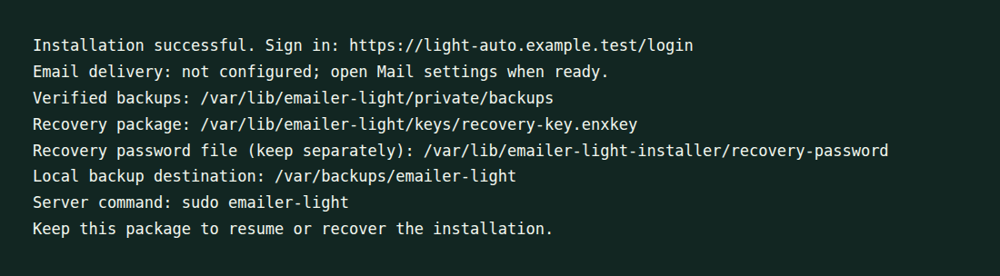

# Install Emailer Light

Version 1.1.0 | Beginner guide | Verified Debian 13 VPS path

Install a usable Emailer Light website with one guided server setup. You need your administrator email, a new password, and the address you want people to use. Email delivery can wait.

## Who can use this guide?

Use a Debian 13 (Trixie), amd64/x86-64 virtual server with systemd and permission to run sudo. The verified setup uses Nginx, PHP 8.4 and MariaDB 10.11 or 11.8. A server with 2 CPU cores, 3 GB memory and a 20 GB disk was tested; setup requires at least 2 GiB free before it starts. Allow additional space for your uploads and backups.

An existing Nginx website can stay on the server, including one using another PHP version. Give Emailer its own hostname. Setup preserves the existing database service and global PHP selection and creates dedicated Emailer resources. Apache, another service on web ports, unsupported database versions, Ubuntu and ARM are outside this release's tested native profile.

Ordinary file-upload/shared hosting is unsupported: Emailer needs a persistent background worker, scheduled maintenance, private key storage outside the website, and dedicated server services. Uploading PHP files alone cannot provide those requirements. Choose the supported VPS path.

## 1. Get your server and website address ready

Sign in to your hosting provider's server console or use its SSH instructions. This is the terminal where you paste the setup action below. You need the provider's server sign-in; it is separate from the new Emailer account.

Choose a spare address such as `news.your-domain.com`. In your domain provider's DNS controls, point its A record to this server's public IPv4 address. Add an AAAA record only if this server actually accepts public IPv6. Allow incoming TCP ports 80 and 443 in the hosting firewall. Do not take over an existing website address. Setup cannot edit your domain or hosting-provider account without access to that account.

## 2. Download the official setup package

In the server terminal, paste this download action. It saves the official installation package in your current folder.

```bash
curl --fail --location --output emailer-light-1.1.0-setup.run \
  https://github.com/Attory/emailer-light/releases/download/v1.1.0/\
emailer-light-1.1.0-setup.run
```

Or download **emailer-light-1.1.0-setup.run** from the [official release](https://github.com/Attory/emailer-light/releases/tag/v1.1.0) in your browser and upload that one file using your provider's file-transfer facility. If curl is unavailable, use that browser download/upload path.

Initial trust comes from obtaining the setup action itself from the official HTTPS release or an authorized private channel. Its embedded, established edition signing identity then verifies the package inventory, runtime and release identity before installer code runs. A key supplied beside an arbitrary download would not establish that initial trust.

## 3. Start setup

From the folder containing the downloaded file, paste this single setup action:

```bash
sudo sh emailer-light-1.1.0-setup.run
```

sudo may ask for your server account password once. Setup needs host permission to install services; the application itself runs under a dedicated account. Keep the terminal open. Password entry is hidden, so no letters or dots may appear.

1. Enter **Application hostname** if asked: just your dedicated address, without https://, a port or a path. Setup does not assume the machine's name is a public website.
2. Enter **Administrator email**. This becomes your sign-in name.
3. Enter a strong **Administrator password** and enter it again. Use 15-256 characters.
4. If the existing database requires its own administrator sign-in, enter those details only at the hidden prompt. A standard local MariaDB setup normally needs no database details.

You will see named progress steps for dependencies, package verification, private folders, database and account, services, backup/recovery, HTTPS and health. Organisation name defaults to Emailer; language to English and scheduling timezone to UTC. SMTP details are not required.



## 4. Sign in

Wait for **Installation successful**. Open the printed HTTPS login address in your browser and sign in with the email and password you entered. Setup has already installed the worker, scheduler, maintenance jobs and command launcher and verified the initial backup. Do not proceed past a browser certificate warning; use the HTTPS troubleshooting entry below.


## 5. Configure email now or later

You can prepare templates and draft campaigns immediately. **Email delivery is not configured** means actual sending is blocked. No campaign is approved or sent during installation.

When ready, open **Settings & tools > Mail settings**. Use your provider's outgoing-mail server, port, encryption, username, SMTP password/key and permitted sender address. The sender name is optional. Saving encrypts the settings; it sends nothing. Choose **Test connection without sending** to check secure connection and sign-in. To send one message, enter your own address in **Test destination** and explicitly choose **Send test email**.


## 6. Keep your recovery information

The completion summary gives your verified backup folder, local backup destination, encrypted recovery-key package and protected recovery-password file. These paths are created automatically. Keep a separate, securely stored copy of the recovery package and its password, using different protected locations. A backup on the same server cannot protect you from losing the server.

For a fresh Light installation, backups are under `/var/lib/emailer-light/private/backups`, the local destination is `/var/backups/emailer-light`, the recovery package is `/var/lib/emailer-light/keys/recovery-key.enxkey`, and the password is `/var/lib/emailer-light-installer/recovery-password`. Host permission is needed to read the password. Never paste it into a support ticket. After updates or edition changes, use the locations printed by that operation.

## If setup stops

| What you see | Smallest next action |
| --- | --- |
| Address/DNS or HTTPS validation failed | Correct the domain records and provider firewall for this server, then run the same setup action again. Saved progress is retained. HTTPS is complete only after validation succeeds. |
| Another service owns port 80 or 443 | Keep that service running. Use a supported Nginx host or a separate supported VPS; do not stop an unrelated site. |
| Debian catalogue cannot be authenticated or is dated in the future | Check the server clock and the named repository connection. Setup will not bypass Debian signature checks. |
| Package authenticity or integrity verification failed | Delete only the failed download, obtain a fresh official setup file, and retry. Keep any existing application and recovery files. |
| Setup interrupted | Run the same action again. It resumes the recorded setup; it does not create another administrator or reset an existing database. |

After successful installation, running the file again opens an installation management menu. **Check the installation** is safe to repeat; an already-installed update leaves settings and delivery state unchanged. For other errors, use the [operator and troubleshooting reference](emailer-light-operator.md). Do not delete installer state or database files to retry.

Next: [Light user manual](emailer-light-manual.md).
