# Emailer Light user manual

Version 1.2.10 | Setup and everyday newsletters

Prepare, test, approve, then send. Saving a draft sends nothing. Light has one administrator and campaign-specific CSV audiences; it has no reusable contacts, lists, additional administrator accounts or MFA.

Ubuntu 26.04 uses its maintained distribution PHP 8.5 packages; no external PHP source is added. A compatible existing MariaDB 10.11 or 11.8 service is reused without a major upgrade. Setup adds a dedicated Emailer PHP-FPM pool and keeps existing website pools, PHP alternatives and Virtualmin-managed websites in place. Missing PHP extension packages add their standard extension configuration; existing PHP settings are retained and shared PHP services are not restarted.

Virtualmin is tested on Ubuntu 26.04.1 with Apache wildcard *:80 and *:443 virtual hosts and two existing PHP websites. Use a spare Emailer hostname that is not already a Virtualmin domain or website alias. Setup creates and manages its own Apache site; it does not register a Virtualmin domain. Manage Emailer through its setup file and application rather than importing or editing that site in Virtualmin. Address-specific Apache virtual hosts require Ripe; Light remains wildcard-only.

Ubuntu 26.04.1 HTTPS acceptance used a local ACME server with real HTTP challenge validation and strict certificate/name verification. Public certificate issuance remains unverified because no dedicated non-production hostname and DNS authority were available. Customer setup uses the normal public ACME service; DNS must point to the server and Apache must be reachable on ports 80 and 443.

Light’s Ubuntu Apache installer supports wildcard virtual hosts. Address-specific Apache websites require Emailer Ripe with its supported address-specific installation profile. Nginx on a separate port, such as 8081, can remain running.

The 1.2.10 setup file supports Ubuntu 22.04/24.04/26.04 with Apache and Debian 13 with Nginx. It creates a dedicated PHP runtime, application services, backups and a command launcher. Ubuntu 22.04 gets an isolated supported database beside existing sites. Administrator email is the default login name on fresh setup; existing accounts keep their identifier and password. You can sign in, prepare templates and campaigns, and configure SMTP later. See the beginner installation guide for the tested hosting profile and one-file setup action.

## Your installed account

Sign in with the administrator email and password chosen during installation. Existing installations retain their login identifier. Fresh defaults are Emailer, English and UTC. The installer has already installed background services and an initial encrypted backup. You can prepare templates and campaigns while sending is unconfigured.

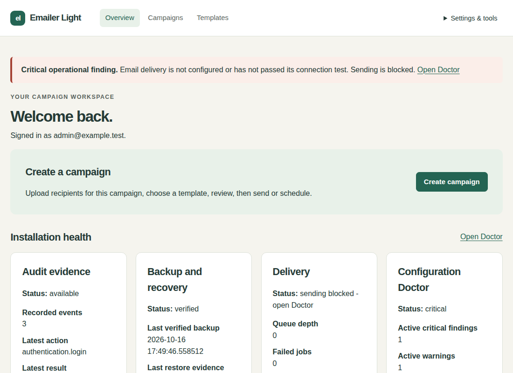

## Configure email when ready

SMTP is optional until you want to send. Sign in, edit templates and prepare campaign drafts without it.

1. Open Settings & tools > Mail settings. Enter your provider server, port, STARTTLS/direct TLS, username, SMTP password/key and permitted sender address. Sender name and reply-to are optional.
2. Choose <strong>Test connection without sending</strong>. It tests the fields currently visible, including a password you entered. It neither sends a message nor saves changes. You can test while delivery is held.
3. If the result says <strong>Current settings tested successfully—save to apply</strong>, choose <strong>Save SMTP settings</strong> to apply those settings. A matching recent successful test is carried into that explicit save. Changing the connection fields or password requires another test.
4. <strong>Test saved connection</strong> is a separate check of the already-saved configuration; it does not apply a different form. A current-form test that exactly matches the saved configuration says so.
5. To send one message, enter your own address in <strong>Test destination</strong>, check that address, and explicitly choose <strong>Send test email</strong>. This uses saved settings and never approves or sends a campaign. An operational delivery hold still blocks this sending action.

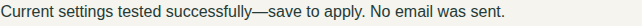

Leave the SMTP password blank only to reuse the saved password for the same server hostname and username. If either changes, enter the password. A new password is tested directly even if the old stored credential cannot be read. Passwords stay in the form during in-place test errors and retries; they are never echoed in responses or saved in browser storage.

If a test fails, correct the named problem: incomplete settings, hostname/DNS, connection refusal or timeout, certificate validation, authentication, or an internal application error. Internal failures show a reference for investigation. Your current fields remain entered. If you edit while a test is running, the result describes the earlier values and asks you to test the current entries.

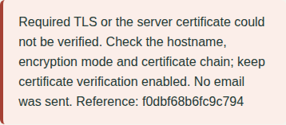

A full-page Save validation error retains non-secret fields and explains that the settings were not saved. Passwords are not redisplayed; enter the SMTP password again if needed. Keep the optional one-click DKIM attestation unticked unless your provider confirms signing both unsubscribe headers.

## Create or edit a template with images

Open Templates to create a draft, or choose Edit for an existing template. Enter the name, subject, optional preheader and HTML. Plain text is optional; leave it blank to generate it when saving. Your image controls are part of this same editor.

1. In Images, choose a JPEG, PNG or WebP file and select Upload and re-encode image. Stay on this page: progress is shown while Emailer validates and saves the image. Uploading keeps your five template fields and HTML cursor position.
2. Choose the saved thumbnail in the gallery. Earlier uploads are available here too; use Refresh gallery or Load more images when needed. You do not need to upload the same image again.
3. Enter a useful Description (alt text), or leave it blank for a decorative image. Adjust Display width if needed; Keep proportions adjusts the height. New selections fit within 600 pixels without enlarging a small image.
4. Place the HTML cursor in text or between tags, then choose Insert image. The supported image reference is generated for you. Copy image HTML copies the complete image tag; Copy image path copies only its address. Neither copy action changes your template.
5. Choose **Save template draft**. Saving stores an unpublished draft. Publication, campaign approval and sending remain separate actions.

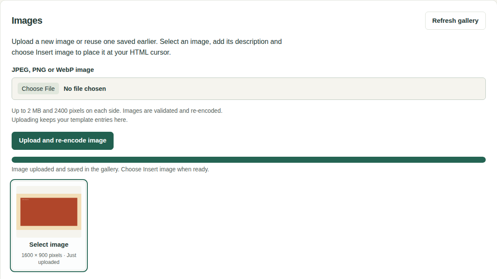

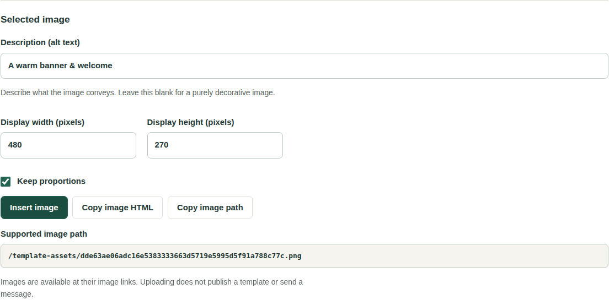

Images must be at most 2 MB and 2400 pixels on each side. Emailer validates and re-encodes them. SVG and other unsupported files are rejected with an explanation. On failure, your entries stay here; correct the file and use Retry upload. If a connection fails after upload started, refresh the gallery before retrying because the image may already have been saved. Cancel also does not remove an image that already reached the server.

Saved image links can be opened without signing in so recipients can see them. Upload only images that are safe to share. The editor uses a relative /template-assets/ image reference; delivered messages automatically use your installation’s HTTPS address. Keep that address and HTTPS working while recipients use those images.

### Recover unsaved work

The editor keeps an unsaved recovery copy in this browser tab for up to 12 hours. After refresh or returning, choose Restore draft to bring back the five fields and HTML cursor, or Discard recovered draft to use the saved version. Each tab has its own copy. Use Save template draft for durable storage; closing the tab may remove browser recovery. Close the tab when finished on a shared computer.

If browser storage is unavailable, the editor says so and warns before you leave with unsaved changes. Keep a copy of your content or save it before leaving. If saving fails validation, your submitted fields remain visible with the error; correct them and save again. Insertion errors leave the HTML unchanged. Uploading, recovering and saving a draft send no messages.

### Placeholders and importing HTML

The Supported placeholders panel beside the editor lists every available placeholder, a sample result and an Insert button. Put the cursor in Subject, Preheader, HTML or Plain text, then choose Insert. The Insert into selector lets you choose the destination explicitly. For example, `{{ recipient.first_name }}` becomes the reader's first name. URL placeholders insert a complete link in HTML, or the URL placeholder itself in Plain text; they cannot be used in Subject or Preheader.

To bring in an existing HTML file, use Import HTML in Templates. The file must be UTF-8 and at most 200 KB. Confirm replacement if HTML is already entered. Importing does not replace the name, subject, preheader or plain text, and does not save or publish anything.

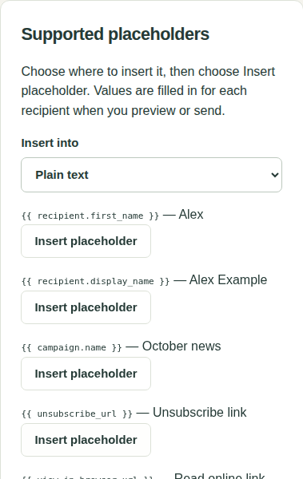

If saving fails, the message names the input field, line and exact offending placeholder, then gives a correction. For example, Subject, line 1, `{{ first_name }}`: use `{{ recipient.first_name }}`. Your five fields remain entered; correct the indicated text and choose Save template draft again. Older `{{name}}` and `{{email}}` forms are unsupported.

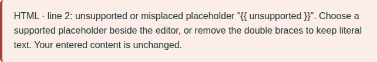

Save template draft stores an unpublished version. Preview it and choose Publish separately when the content is ready for campaign tests and review. Saving, importing HTML and uploading images do not publish a template, approve a campaign or send email. A new template version never silently replaces an existing campaign's chosen version.

## Create a campaign

1. Open Your campaigns. Under Create a campaign enter an internal campaign name, optionally set a sending rate and choose a saved template. The name is not the email subject. Leave the rate blank to use the installation maximum.
2. Choose a recipient CSV. It belongs only to this campaign; saving it does not create a reusable contact or recipient list. Use UTF-8 with an email header. Optional headers are display_name, first_name, last_name, locale and time_zone.
3. Choose Save draft. You can save before selecting a template, and even before giving the campaign a name. Review imported, duplicate, invalid and suppressed counts after saving. Existing saved recipients remain when you save without choosing a replacement CSV. Only contact people you have permission to email.
4. Open the campaign summary to see anything still required. Review and approval remain unavailable until there is a name, a published template and eligible recipients. A saved template draft appears in the selector but must be explicitly published in Templates before testing or review.

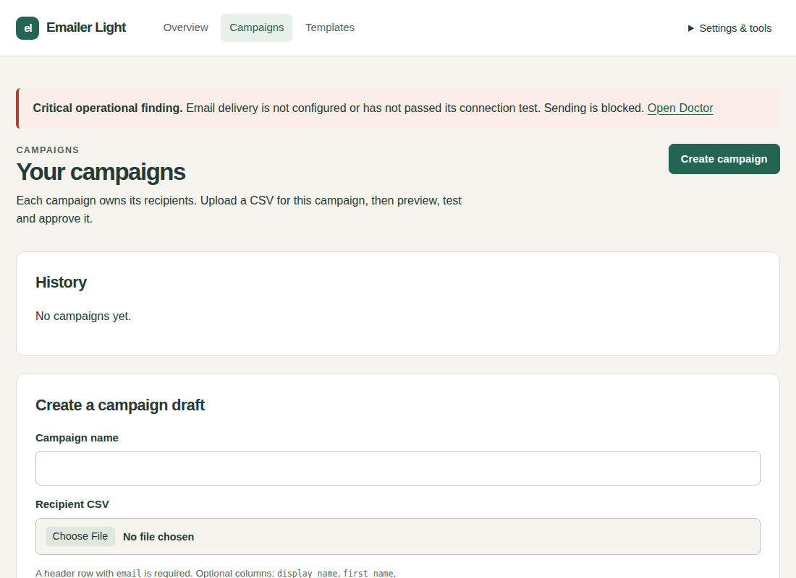

### Create a template and return

Next to the template selector choose **or create new Template**. A blank, unchanged campaign opens Templates directly. With unsaved changes the dialog asks **Save your Campaign draft before leaving?**

- Save draft and open Templates saves the name, rate and selected CSV, even without a template. After successful saving, Templates shows Return to campaign draft.
- Leave without saving opens Templates and discards your unsaved changes. Previously saved campaign data remains.
- Stay here, or Escape, closes the dialog and keeps the form and selected file.

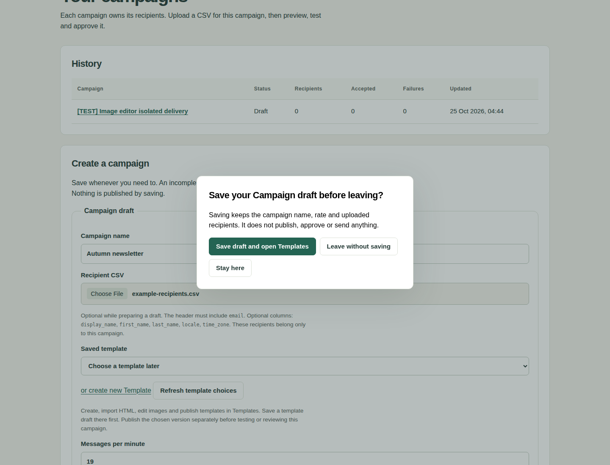

In Templates use the dedicated editor to enter or import HTML, add images from the persistent gallery and choose Save template draft. Choose Publish explicitly when ready. Then choose Return to campaign draft. The campaign reopens with its saved name, rate and recipients and fresh template choices. Choose the new version and Save draft. If Templates is open in another tab, return to the campaign tab and choose Refresh template choices; this refreshes only the selector and keeps your unsaved fields and selected CSV.

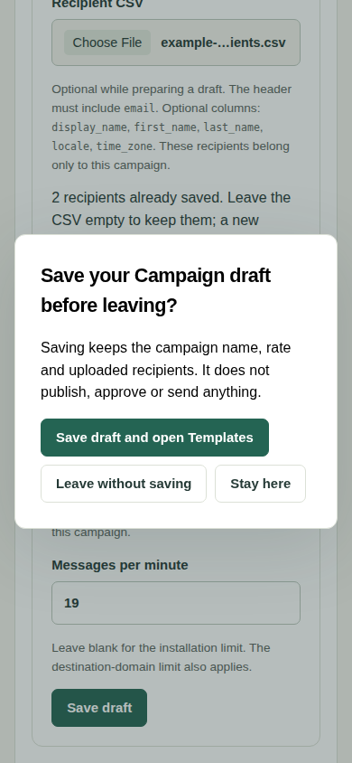

### If campaign saving fails

Stay on the form, read the specific error, correct it and try Save draft again. With JavaScript enabled, validation and connection failures keep the actual selected CSV and entered fields. If your session expired, sign in in another tab, return here and choose Refresh security check before retrying. A connection failure may mean the result could not be confirmed; check Your campaigns in another tab before creating a second campaign.

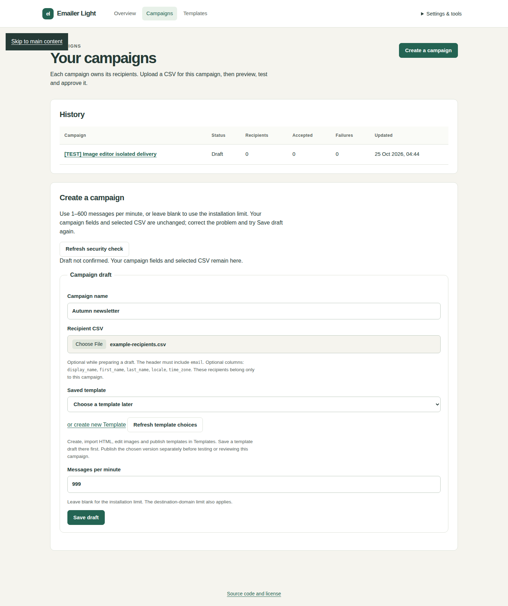

Save draft before refreshing or closing the campaign tab: unsaved navigation triggers a browser warning. Campaign files are not stored in browser draft recovery. Without JavaScript, a failed full-page submission retains text but the browser requires you to select the CSV again. Template editor recovery is separate and retains its five text fields per tab. Saving or navigating never publishes content, approves a campaign or sends email.

While Draft or Review, use Edit draft to change the campaign. Saving Review returns it to Draft and invalidates its earlier test. A replacement CSV replaces only that campaign's owned recipients. Approved content and audience snapshots stay immutable; changed approved work needs a new campaign.

## Test, approve and send

1. Send a test to the administrator address. Check subject, content, images, links and unsubscribe footer in the actual message. This requires configured email and passing sending checks.
2. Review the current campaign revision and recipient counts. Approve only when satisfied. Approval freezes the selected audience and content.
3. Choose Send now or schedule as a separate action. Use the displayed organisation timezone; fresh installations use UTC. Approval alone sends nothing.

To change approved content or recipients, make a new campaign. A newer template version does not silently replace the selected campaign version. Global suppression is checked again immediately before delivery.

## Read progress and handle problems

- SMTP accepted means the server accepted the message, not proven inbox placement.
- Installation, domain and concurrency limits can make a campaign take longer than its requested rate.
- Pause stops new claims; a message in flight may finish. Cancel remaining deliveries cannot recall sent messages.
- Uncertain outcomes are not automatically resent. Inspect the history before deciding on a follow-up.
- Open/click reports can be distorted by privacy tools, image blocking and scanners; they do not prove a human read.
- Open Settings & tools > Doctor for the exact sending blocker and repair action.

## Backups and account care

Fresh setup enables daily encrypted local backup copies. Open Backups to inspect verified backup/transfer evidence, adjust policy or Create and verify local backup. Local copies are on this server; arrange a separate protected destination for server-loss protection. Keep the recovery-key package and its password in separate protected locations. A restore-drill reminder does not automatically restore anything.

Use Profile for your account and Sessions to review access. Lost administrator passwords are recovered through the protected server command with hidden input. See the operator reference. Keep recipient exports and backups private.

## Updates

If host setup stops, sending stays blocked and the saved operation records the failure. A committed update can be finished with the same setup file after correcting its reported service or storage problem. Do not delete its state or database.

Setup creates and verifies its recovery backup. If automatic backups are enabled, it also refreshes and verifies that same encrypted backup at the already-configured destination before changing the application. It keeps your backup policy and does not run retention or send email. If the approved copy cannot be verified, sending remains held and setup names the blocker. Keep the recovery material; follow the displayed Recover or Finish action after correcting the backup folder or storage problem.

1. Official Light 1.0.0, 1.1.0 and 1.2.0 through 1.2.9 retain their supported direct update to 1.2.10. Start the signed setup and check the displayed installation address.
2. Choose Update with a verified backup. The installer tracks its own operation hold and drains current work without retrying failed or uncertain messages.
3. Successful completion retires only this operation’s hold. Existing owner pauses and other holds remain; Doctor names any actual SMTP or readiness blocker. Previously approved due work can continue when delivery was already enabled and readiness passes.
4. For an interrupted operation use its retained Finish or Recover action. Recovery remains held until explicitly reviewed. Keep the verified recovery material.

For an interruption, retain the same package and recovery files and choose Recover. A completed update cannot be undone by replaying recovery. See the [operator reference](emailer-light-operator.md). Installation is described in the [beginner guide](emailer-light-install.md). A compatible edition upgrade is separate; there is no general Ripe to Light downgrade.

Light 1.2.6 and 1.2.10 use the same database schema. Older installations need the guided draft-schema migration; keep verified recovery material. Normal restore needs the same schema. Recover older backups with their matching release in an isolated environment. For interrupted updates choose Recover in setup; a completed update cannot be downgraded through recovery.

Template version actions use compact text controls with keyboard focus and wrapping on small screens. Synthetic preview opens a read-only preview. Run fake-only test and Publish remain explicit protected form submissions; saving a template draft does neither.

## Installer holds and owner pauses

A successful operation releases only its own temporary installer hold after runtime verification and any required Accept action. An independent owner pause or another operation hold remains. Doctor reports the actual MFA, SMTP or other readiness requirement instead of calling a completed installation unfinished. Completing a requirement can allow previously approved due work to continue if the owner already enabled delivery; inspect that work before changing readiness.

An interrupted or recovered operation retains its operation identifier, lifecycle and Finish or Recover action. Use the same verified setup and retained recovery material. Failed and uncertain messages are never retried by completion. An unattributed legacy hold remains unknown until its owner explicitly reviews and resumes it; a zero delivery flag alone never proves installer ownership.

After recovery to an older release, that release may record Pause only in its database. A standalone retry treats its zero delivery flag as unknown intent instead of automatically restoring inferred enabled intent. Successful retry retires only the installer holds; review readiness and use supported Resume explicitly. A newer independently recorded owner pause is preserved. Use this signed follow-up rather than the standalone recovery/retry route in 1.2.9.
