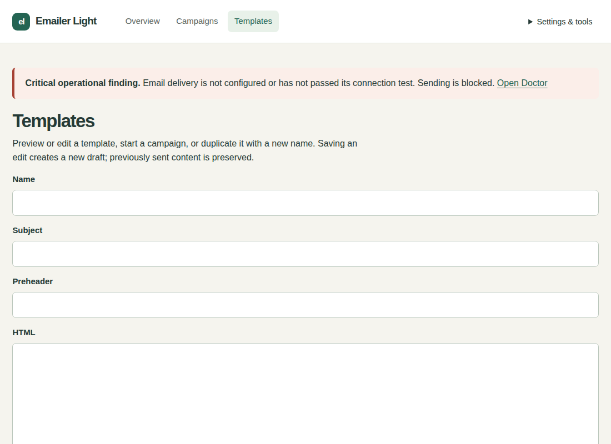

# Emailer Light user manual

Version 1.2.2 | Setup and everyday newsletters

Prepare, test, approve, then send. Saving a draft sends nothing. Light has one administrator and campaign-specific CSV audiences; it has no reusable contacts, lists, additional administrator accounts or MFA.

The 1.2.2 setup file supports Ubuntu 22.04/24.04 with Apache and Debian 13 with Nginx. It creates a dedicated PHP runtime, application services, backups and a command launcher. Ubuntu 22.04 gets an isolated supported database beside existing sites. Administrator email is the default login name on fresh setup; existing accounts keep their identifier and password. You can sign in, prepare templates and campaigns, and configure SMTP later. See the beginner installation guide for the tested hosting profile and one-file setup action.

## Your installed account

Sign in with the administrator email and password chosen during installation. Existing installations retain their login identifier. Fresh defaults are Emailer, English and UTC. The installer has already installed background services and an initial encrypted backup. You can prepare templates and campaigns while sending is unconfigured.


## Configure email when ready

1. Open Settings & tools > Mail settings. Use your provider server, port, STARTTLS or direct TLS, username, SMTP password/key and allowed sender address. Sender name and reply-to are optional.
2. Choose Store secure SMTP configuration. It encrypts settings and sends nothing. Leave the password blank only to retain the saved password for the same server and username. A new server or login needs its password.
3. Choose Test connection without sending to validate the certificate and sign-in without emailing anyone.
4. For one explicit message, enter your own address in Test destination, check the address, and choose Send test email. This does not approve a campaign.


Provider suggestions are conveniences; use your account's current settings. Leave the optional one-click DKIM confirmation unticked unless your provider confirms signing both unsubscribe headers. Normal unsubscribe links work independently.

## Prepare a template

1. Open Templates and create a template with a recognizable name, email subject and HTML. Plain text is optional; leave it blank to generate it automatically. Preview and save/publish the version you intend to use.
2. Upload images through the template asset controls and use the returned asset address. Unsafe HTML and remote image sources are removed.
3. Use the supported fields shown by the editor, such as `{{ recipient.first_name }}` and `{{ unsubscribe_url }}`. Older `{{name}}` and `{{email}}` forms are unsupported.



## Create a campaign and upload recipients

1. Open Campaigns, create a campaign and select a template version. The internal campaign name is separate from the email subject.
2. Upload a UTF-8 CSV with an email header. Optional headers are display_name, first_name, last_name, locale and time_zone. Review imported, invalid, duplicate and suppressed counts. Only email people you have permission to contact.
3. While Draft or Review, replace or delete this campaign's upload if needed. Each campaign owns its recipients; uploads do not create reusable lists. A change invalidates the earlier test.

```csv
email,first_name
reader@example.test,Sample
```


## Test, approve and send

1. Send a test to the administrator address. Check subject, content, images, links and unsubscribe footer in the actual message. This requires configured email and passing sending checks.
2. Review the current campaign revision and recipient counts. Approve only when satisfied. Approval freezes the selected audience and content.
3. Choose Send now or schedule as a separate action. Use the displayed organisation timezone; fresh installations use UTC. Approval alone sends nothing.

To change approved content or recipients, make a new campaign. A newer template version does not silently replace the selected campaign version. Global suppression is checked again immediately before delivery.

## Read progress and handle problems

- SMTP accepted means the server accepted the message, not proven inbox placement.
- Installation, domain and concurrency limits can make a campaign take longer than its requested rate.
- Pause stops new claims; a message in flight may finish. Cancel remaining deliveries cannot recall sent messages.
- Uncertain outcomes are not automatically resent. Inspect the history before deciding on a follow-up.
- Open/click reports can be distorted by privacy tools, image blocking and scanners; they do not prove a human read.
- Open Settings & tools > Doctor for the exact sending blocker and repair action.

## Backups and account care

Fresh setup enables daily encrypted local backup copies. Open Backups to inspect verified backup/transfer evidence, adjust policy or Create and verify local backup. Local copies are on this server; arrange a separate protected destination for server-loss protection. Keep the recovery-key package and its password in separate protected locations. A restore-drill reminder does not automatically restore anything.

Use Profile for your account and Sessions to review access. Lost administrator passwords are recovered through the protected server command with hidden input. See the operator reference. Keep recipient exports and backups private.

## Updates

1. Download the official new Light setup file and start it using the installation action. Light 1.0.0, 1.1.0, 1.2.0 and 1.2.1 can update directly to 1.2.2. Check the displayed address before choosing an action.
2. Choose Update with a verified backup. Setup pauses delivery, verifies recovery material and checks the updated application. Follow any Finish a committed update instruction.
3. Review Doctor and mail settings. Start the same file and choose Resume delivery after reviewing readiness when ready. Previously approved due work may continue after resume; no draft is approved by this action.

For an interruption, retain the same package and recovery files and choose Recover. A completed update cannot be undone by replaying recovery. See the [operator reference](emailer-light-operator.md). Installation is described in the [beginner guide](emailer-light-install.md). A compatible edition upgrade is separate; there is no general Ripe to Light downgrade.
